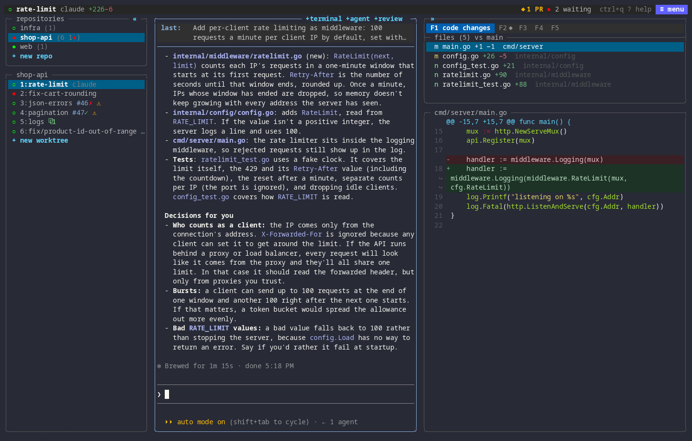

# nerdr

[website](https://nerdr.app/) ·
[install](https://nerdr.app/start/install/) ·
[quick start](https://nerdr.app/start/quick-start/) ·
[docs](https://nerdr.app/start/about/)

[](https://github.com/nerdr-dev/nerdr/actions/workflows/ci.yml)
[](LICENSE)

**Run a team of coding agents, each in its own Git worktree, and review
their work, all in one terminal.**



*A new tab with Codex, the repositories and their status lights, Claude's
changes in the review panel, the tests in a terminal, Codex reviewing
Claude's work, and the waiting list taking you to the agent with a
question.*

- **One task, one tab.** Each tab gets a branch and a worktree from the
  latest `main`, and the agent you pick. Start from an issue, a pull
  request or another tab's branch. [Tabs and worktrees →](https://nerdr.app/use/tabs/)
- **See who needs you.** Status lights show which agents work, wait for
  input or are done; the waiting list takes you to them. [Progress →](https://nerdr.app/use/progress/)
- **A workbench per tab.** Terminals, more agents and code reviews beside
  the agent, in the same worktree. Agents message each other and share
  out the work. [The workbench →](https://nerdr.app/use/workbench/)
- **Review before you merge.** Word-level diffs, the agent's notes on why,
  guided walkthroughs, and a second agent that reviews the work and sends
  findings back. [Code review →](https://nerdr.app/use/code-review/)
- **From task to merge.** Commit, push, open pull requests, hand review
  comments and failing CI to the agent, and close the tab when it is
  merged. [GitHub →](https://nerdr.app/panel/github/)
- **Your agents, as they are.** Claude Code, Codex, Copilot, opencode,
  Cursor, Gemini and Antigravity, with their own settings, in a sandbox
  if you like. [Agents →](https://nerdr.app/configure/agents/)
- **Your own scripts as plugins.** Custom scripts (like rebuilding Docker or
  seeding a database) that agents can run with parameters, or that you can
  run directly in `F5`. [Plugins →](https://nerdr.app/configure/plugins/)
- **Keyboard and mouse.** Everything is a key after `ctrl+q`, and a click.
  [Keys →](https://nerdr.app/configure/keyboard/)

## Install

On Linux or macOS:

```sh
curl -fsSL https://nerdr.app/install.sh | sh
```

or with Homebrew, `brew install nerdr-dev/tap/nerdr`, or with Go 1.27 or
newer, `go install github.com/nerdr-dev/nerdr/cmd/nerdr@latest`. The
binaries are also on the [releases page](https://github.com/nerdr-dev/nerdr/releases).
You need `git` and at least one coding agent on your PATH. Sign in to `gh`
for pull requests, CI and issues. See [install](https://nerdr.app/start/install/)
for the details and for building from source.

Start it in the folder that holds your repositories:

```sh
cd ~/develop
nerdr
```

Pick one or more repositories, name a branch, choose an agent, and it starts
working. Press `ctrl+q ?` to find any command. See the
[quick start](https://nerdr.app/start/quick-start/).

## Docs

Everything lives at [nerdr.app](https://nerdr.app/):

[about](https://nerdr.app/start/about/) ·
[concepts](https://nerdr.app/start/concepts/) ·
[tabs and worktrees](https://nerdr.app/use/tabs/) ·
[the workbench](https://nerdr.app/use/workbench/) ·
[agents together](https://nerdr.app/use/agents-together/) ·
[code review](https://nerdr.app/use/code-review/) ·
[review panel](https://nerdr.app/panel/overview/) ·
[configuration](https://nerdr.app/configure/configuration/) ·
[keyboard](https://nerdr.app/configure/keyboard/) ·
[plugins](https://nerdr.app/configure/plugins/) ·
[remote machines](https://nerdr.app/use/remote/) ·
[security](https://nerdr.app/reference/security/)

## Inspired by herdr

nerdr builds on [herdr](https://herdr.dev)'s status lights, mouse controls
and rules for detecting an agent's state; see [NOTICE](NOTICE). Run nerdr
inside herdr to keep agents running when you detach, or on another
machine.

## Development

```sh
make build    # ./nerdr
make test     # unit tests
make e2e      # the real binary in a pseudo-terminal with a fake agent
```

The docs site is in [`docs/`](docs); see
[Development](https://nerdr.app/reference/development/).

## License

[Apache License 2.0](LICENSE)
