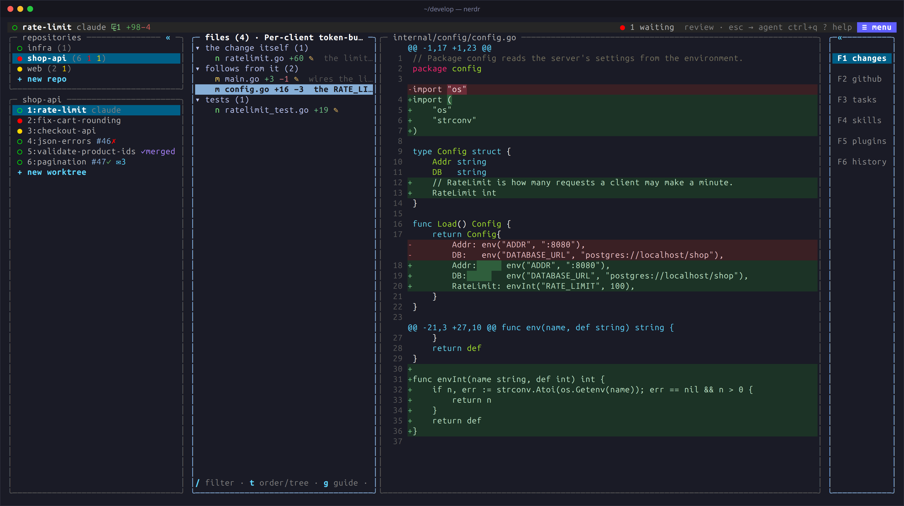
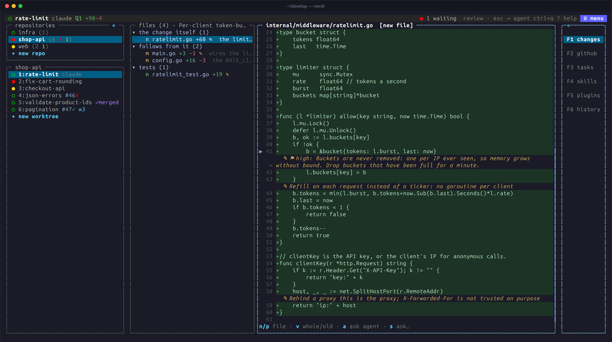
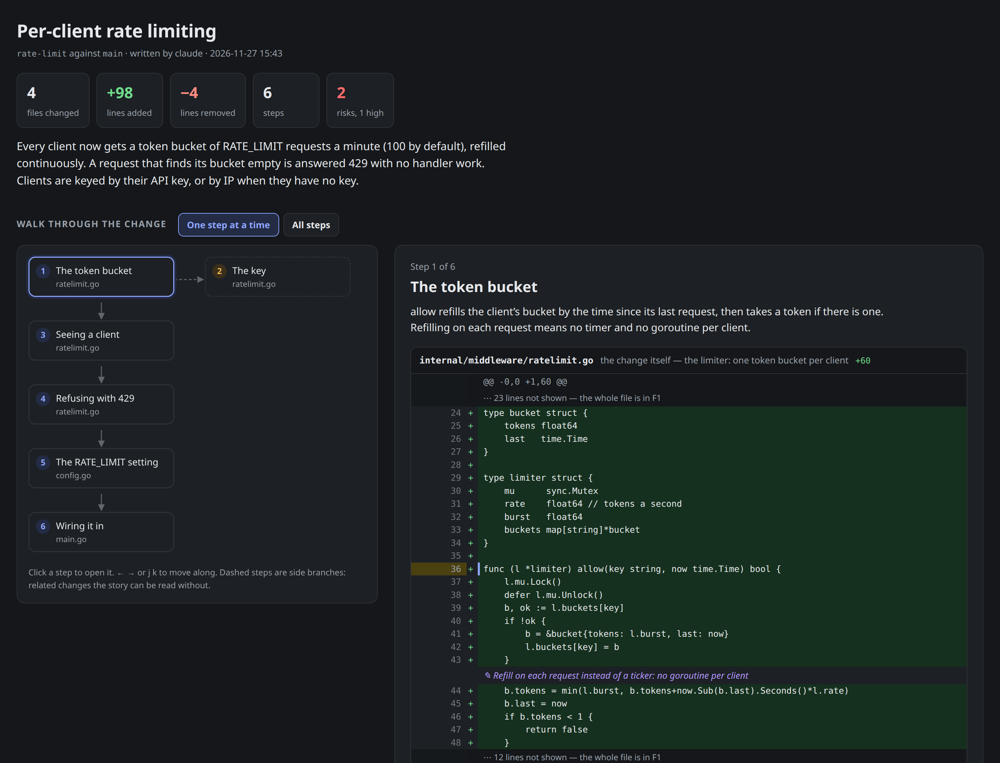

import { Aside } from '@astrojs/starlight/components';

F1 shows what the agent changed, against main or against the branch the
tab was stacked on: a list of files, and the diff of the one selected,
with the changed words marked. It follows the worktree live, so you can
watch the change take shape while the agent works.

## The file list

| Key | Action |
|---|---|
| `↑` / `↓` | Select a file |
| `b` | Compare the whole branch with main |
| `t` | Order by reading order, import groups or folders |
| `d` | Show / hide explanations and folder paths |
| `e` | Show the full explanation and notes |
| `/` | Filter the files |
| `L` | Put the list beside the diff, or back above it |
| `o` | Open the file in your editor, at the current line |

Marks in the list:

- `◆` a file changed since your last visit, including new edits to a
  file that was already changed. `●` marks a live edit, briefly.
- `✎` a file with notes from the agent.
- `⚑` a file with findings from a [code review](../../use/code-review/).
- `»2` a file with your own [comments](#commenting-on-lines), and how
  many.

In a tab on several repositories, the top row of the list shows the
repositories, each with the number of files its branch changes. Click
one, press `[` / `]`, or `↑` from the first file and then `←` / `→`.

The list is above the diff while the agent is beside the panel. When the
panel has the screen to itself and is at least 130 columns wide, the list
goes beside the diff.

## The diff

| Key | Action |
|---|---|
| `v` | Cycle: the diff, the whole file with changes marked, the old code |
| `a` | Ask the agent what this line does and why, on any line, unchanged code too |
| `s` | Write your own question about it |
| `r` | Comment on the line, or on the lines chosen; on a comment, change it |
| `R` | Send all the comments to the agent, in one message |
| `c` | Switch between GitHub's dark diff and nerdr's own colours |

The diff is drawn as GitHub draws one in its dark mode, in its colours:
GitHub's background, the old and the new line number side by side, in a
stronger tint on a changed line, each hunk's `@@` header on a blue band,
and the code coloured by its syntax on every line, changed ones too.
`diff_colors = "nerdr"` starts with nerdr's own softer colours and the
new line number only.

Drag over lines to copy their code when you let go: whole lines, without
the `+` and `-`, line numbers or hunk headers.

`o` opens the file at the current line in `editor`, else `$VISUAL`,
`$EDITOR` or `vim`. Graphical editors open their own window, and VS Code
uses the worktree's window. Terminal editors take over the screen until
they exit.

## Commenting on lines

Read through the change as you would a pull request before merging it,
leave comments as you go, and send them to the agent together when you
are done, rather than one question at a time.

| Key | Action |
|---|---|
| `r` | Write a comment on the line under the cursor |
| `shift+↑` / `shift+↓` | Choose several lines in one hunk to comment on; dragging over them works too |
| `enter` or `r` on a comment | Change it; empty it to delete it |
| `x` on a comment | Delete it |
| `R` | Send all the comments on the change shown to the agent |

A comment is shown above its line, marked `»`, as the agent's notes and
a reviewer's findings are, and the file list marks the files that have
comments. Comments can go on added, unchanged or removed lines, in the
diff or the whole file (`v`), and on a file you jumped to outside the
change. A comment on removed lines is shown in the diff only, as the
whole file does not have them.

`R` sends the comments of every file in one message: each with its file
and line, the code it is on, and what you wrote. The message opens for
you to read and change first, as tasks do (see [Tasks](../tasks/)), and
waits in F3 until the agent is idle. The comments are kept until the
message is sent; cancel it and they are still there.

When the agent changes a file, its comments move with the code they are
on. A comment whose code has been rewritten, any line of it, is marked
**outdated** at the top of the file's diff, and sent with a note saying
so. Comments are kept in `review-comments.json` in nerdr's state folder
(`~/.local/state/nerdr`), so they survive a restart, and are shared by
the nerdrs that use that folder.

## Explaining a change

Ask the agent to **"explain the code for nerdr"**, use `/nerdr-explain`
in Claude, or press `E` in the file list to prepare the request. The
agent then adds:

- **A one-line summary** above the file list.
- **A line on each file** beside its name, saying the part it plays. The
  main changes come first; mechanical edits come last, folded.
- **Notes above the changes that need them**, such as a constraint or a
  subtle effect, which the diff alone does not tell you.

Explanations are written only when you ask, since they cost the agent
tokens. E includes the writing instructions in the request, so it works
even with `nerdr-explain` turned off or uninstalled. The skill, on by
default, lets the agent discover this workflow from conversation too.

## A walkthrough of a change

For a larger change, ask for **"a walkthrough for nerdr"**, or press `g`
in the file list. `g` (or `G` for a new version) includes the necessary
instructions and works with the skill off. The agent works out where the
change starts and writes a guided tour of it, usually five to ten steps grouped by what they do
rather than by file. It opens as a page in your browser:

- A short summary, with the number of files, lines, steps and risks.
- The flow of the steps. Side branches, such as tests, sit beside the
  main path.
- One step at a time: what happens and why, with the diff hunks it points
  at and the notes on their lines. `←` `→` move between steps, or show
  them all at once.
- The risks the agent sees, and the changed files the walkthrough leaves
  out.

If you are watching the agent while it writes, the page opens as soon as
it is done.

Once there is a walkthrough, `g` opens it, and `G` asks the agent for a
new one. If files have changed since the walkthrough was written, the
button says **guide (old)**.

<Aside>
The agent writes only the structure. nerdr draws the code from git each
time you press `g`, so the walkthrough always matches the change. The
page fetches and sends nothing.
</Aside>
