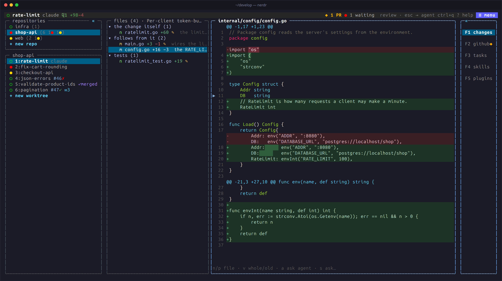
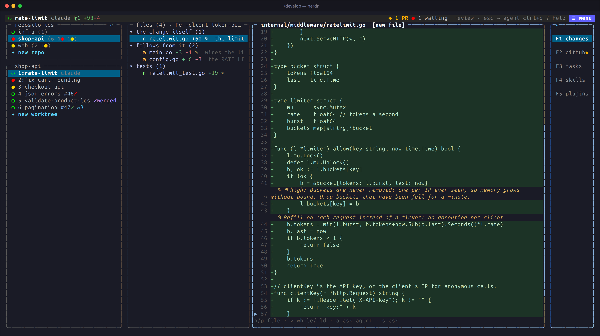
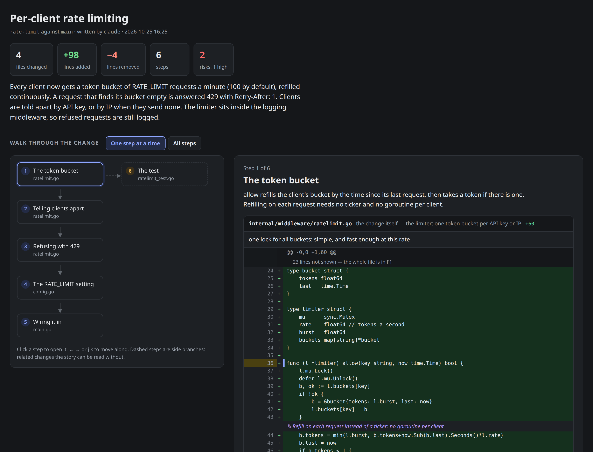

import { Aside } from '@astrojs/starlight/components';

F1 shows what the agent changed, against main or against the branch the
tab was stacked on: a list of files, and the diff of the one selected,
with the changed words marked. It follows the worktree live, so you can
watch the change take shape while the agent works.

## The file list

| Key | Action |
|---|---|
| `↑` / `↓` | Select a file |
| `b` | Compare the whole branch with main |
| `t` | Order by reading order, import groups or folders |
| `d` | Show / hide explanations and folder paths |
| `e` | Show the full explanation and notes |
| `/` | Filter the files |
| `L` | Put the list beside the diff, or back above it |
| `o` | Open the file in your editor, at the current line |

Marks in the list:

- `◆` a file changed since your last visit, including new edits to a
  file that was already changed. `●` marks a live edit, briefly.
- `✎` a file with notes from the agent.
- `⚑` a file with findings from a [code review](../../use/code-review/).

In a tab on several repositories, the top row of the list shows the
repositories, each with the number of files its branch changes. Click
one, press `[` / `]`, or `↑` from the first file and then `←` / `→`.

The list is above the diff while the agent is beside the panel. When the
panel has the screen to itself and is at least 130 columns wide, the list
goes beside the diff.

## The diff

| Key | Action |
|---|---|
| `v` | Cycle: the diff, the whole file with changes marked, the old code |
| `a` | Ask the agent what this line does and why, on any line, unchanged code too |
| `s` | Write your own question about it |
| `c` | Switch between nerdr's colours and GitHub's dark diff and syntax colours |

Drag over lines to copy their code when you let go: whole lines, without
the `+` and `-`, line numbers or hunk headers. `diff_colors = "github"`
starts with GitHub's colours.

`o` opens the file at the current line in `editor`, else `$VISUAL`,
`$EDITOR` or `vim`. Graphical editors open their own window, and VS Code
uses the worktree's window. Terminal editors take over the screen until
they exit.

## Explaining a change

Ask the agent to **"explain the code for nerdr"**, use `/nerdr-explain`
in Claude, or press `E` in the file list to prepare the request. The
agent then adds:

- **A one-line summary** above the file list.
- **A line on each file** beside its name, saying the part it plays. The
  main changes come first; mechanical edits come last, folded.
- **Notes above the changes that need them**, such as a constraint or a
  subtle effect, which the diff alone does not tell you.

Explanations are written only when you ask, since they cost the agent
tokens. They need the `nerdr-explain` skill, on by default.

## A walkthrough of a change

For a larger change, ask for **"a walkthrough for nerdr"**, or press `g`
in the file list. The agent works out where the change starts and writes
a guided tour of it, usually five to ten steps grouped by what they do
rather than by file. It opens as a page in your browser:

- A short summary, with the number of files, lines, steps and risks.
- The flow of the steps. Side branches, such as tests, sit beside the
  main path.
- One step at a time: what happens and why, with the diff hunks it points
  at and the notes on their lines. `←` `→` move between steps, or show
  them all at once.
- The risks the agent sees, and the changed files the walkthrough leaves
  out.

<Aside>
The agent writes only the structure. nerdr draws the code from git each
time you press `g`, so the walkthrough always matches the change. The
page fetches and sends nothing.
</Aside>
