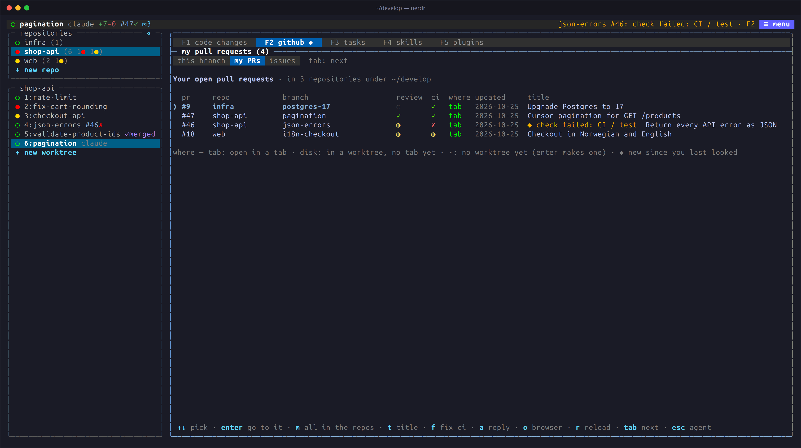

import { Aside } from '@astrojs/starlight/components';

F2 takes a tab from finished work to a pull request, and back to the
agent when review comments or CI need it. It needs the GitHub CLI, `gh`,
signed in.

F2 has three views. Press `F2` again or `tab` to go to the next,
`shift+tab` to go back. A `◆` marks news you have not seen, and F2 opens
on that view.

## This branch

The tab's branch: its commits, changes, pull request, review comments and
CI checks. `ctrl+q i i` opens it from anywhere. To open the pull request
in your browser, press `o` here or `ctrl+q i b` from the agent, or click
its number (`#12`) in the tab details.

| Key | Action |
|---|---|
| `c` | Commit every change, new files too, with the message you type; then, as picked in the dialog with `tab`, push, or push and open a pull request |
| `p` | Push |
| `P` | Push and open a pull request |
| `a` | Draft a reply to the review comment selected, for the agent to act on |
| `A` | Draft replies to all comments |
| `f` | Ask the agent to fix the failing CI job, with its log |

Push and pull request actions ask for `y` or `enter` first. Actions that
cannot be done are dimmed: push with nothing to push, a pull request when
every branch with commits has one, fix CI when no check fails.

In a tab on several repositories, each branch has a row: `←` goes up to
them, `↑` `↓` pick the one whose pull request is shown, and `enter` goes
down to its comments.

## My PRs

Your open pull requests across these repositories (`ctrl+q i p`). The
cursor starts on the tab's own pull request.

| Key | Action |
|---|---|
| `enter` | Go to the tab on that branch, or make a worktree and a tab for it |
| `a` / `f` | Prepare the comments or the CI fix for the tab on that branch |
| `t` | Show the whole title |
| `m` | Everyone's open pull requests. Those that ask for your review are marked `● review asked` and listed first. `m` again goes back to yours |
| `o` | Open the pull request in your browser |

Requests from this view wait in the target tab's F3, without switching
tabs. A pull request from a fork shows its branch as `owner:branch`;
`enter` fetches it into a branch of its own, `pr-<n>-<branch>`, which
nerdr never pushes.

nerdr watches your pull requests for failed checks and new reviews, and
tells you in the bar, with `◆` on F2, and on the desktop. Set
`pr_notify = false` to turn this off.

## Issues

Issues assigned to you across these repositories (`ctrl+q i o`).

| Key | Action |
|---|---|
| `enter` | Go to the tab working on the issue (a branch named `123-…`), or prepare a new tab |
| `a` | All open issues |
| `t` | Only the tab's repositories |
| `o` | Open the issue in your browser |

nerdr checks assigned issues every few minutes and tells you of new ones
the same way. Set `issue_notify = false` to turn this off.

## How often nerdr asks GitHub

nerdr checks the tab on screen every `github_refresh` seconds (90 by
default); other checks scale with it. `ctrl+q g` counts the git and `gh`
calls per tab and by command, live.

<Aside type="caution" title="Read drafts before sending">
Review comments and CI logs contain text written by others. They may
include instructions meant for the agent, and the agent acts within its
permissions. Drafts open for you to read and edit before they are sent.
</Aside>
