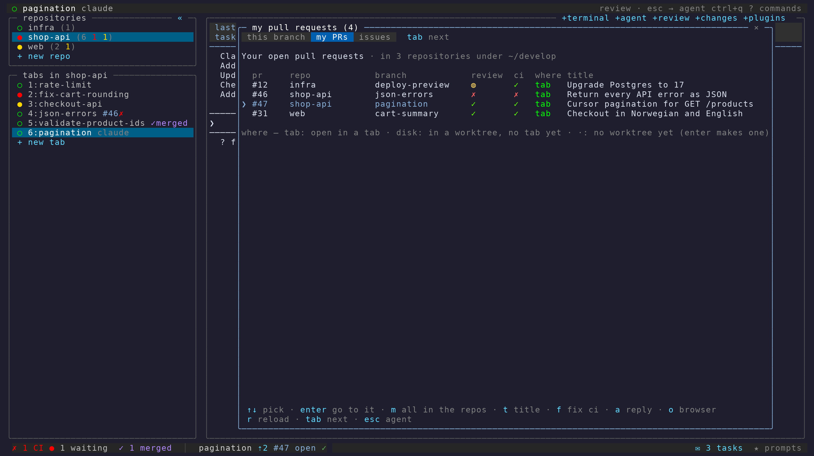

import { Aside } from '@astrojs/starlight/components';

F2 takes a tab from finished work to a pull request, and back to the
agent when review comments or CI need it. It needs the GitHub CLI, `gh`,
signed in, for repositories on GitHub, and the GitLab CLI, `glab`, for
those on GitLab: a tab, and the lists, can hold both at once. See
[GitLab](#gitlab) below.

F2 has three views. Press `F2` again or `tab` to go to the next,
`shift+tab` to go back. A `◆` marks news you have not seen, and F2 opens
on that view.

## This branch

The tab's branch: its commits, changes, pull request, review comments and
CI checks. `ctrl+q g g` opens it from anywhere. To open the pull request
in your browser, press `o` here or `ctrl+q g b` from the agent, or click
its number (`#12`) in the tab details.

| Key | Action |
|---|---|
| `c` | Commit every change, new files too, with the message you type; then, as picked in the dialog with `tab`, push, or push and open a pull request |
| `p` | Push |
| `P` | Push and open a pull request |
| `a` | Draft a reply to the review comment selected, for the agent to act on |
| `A` | Draft replies to all comments |
| `f` | Ask the agent to fix the failing CI job, with its log |

Push and pull request actions ask for `y` or `enter` first. Actions that
cannot be done are dimmed: push with nothing to push, a pull request when
every branch with commits has one, fix CI when no check fails.

In a tab on several repositories, each branch has a row: `←` goes up to
them, `↑` `↓` pick the one whose pull request is shown, and `enter` goes
down to its comments.

## My PRs

Your open pull requests across these repositories (`ctrl+q g p`). The
cursor starts on the tab's own pull request.



| Key | Action |
|---|---|
| `enter` | Go to the tab on that branch, or make a worktree and a tab for it |
| `a` / `f` | Prepare the comments or the CI fix for the tab on that branch |
| `t` | Show the whole title |
| `m` | Everyone's open pull requests. Those that ask for your review are marked `● review asked` and listed first. `m` again goes back to yours |
| `o` | Open the pull request in your browser |

Requests from this view wait in the target tab's F3, without switching
tabs. A pull request from a fork shows its branch as `owner:branch`;
`enter` fetches it into a branch of its own, `pr-<n>-<branch>`, which
nerdr never pushes.

nerdr watches your pull requests for failed checks and new reviews, and
tells you in the bar, with `◆` on F2, and on the desktop. Set
`pr_notify = false` to turn this off.

### Asking the agent by itself

nerdr can write the `f` or `a` message by itself when a check fails or a
review comes in, and ask the agent to rebase when the pull request
conflicts with its base. Turn this on per event in
[`[auto]`](../../configure/configuration/#automatic-asks):

```toml
[auto]
ci_failed = "ask"         # or "auto"
review_comments = "ask"
conflicts = "auto"
```

With `ask`, the message waits in the tab's F3 for you to read and send,
and nerdr tells you. With `auto`, it is sent when the agent is idle.
F3 marks a message nerdr wrote with `by nerdr`. The tab's panel shows an
`auto:` row, and the history (F5) records when it was sent.

nerdr waits until the CI run has ended, and acts once per head commit. It
sends at most `max_tries` (3) in a row for one pull request. It does not
wake a tab that is asleep or cold unless `wake = true`. In each of these
cases the message waits for you instead.

## Issues

Issues assigned to you across these repositories (`ctrl+q g o`).

| Key | Action |
|---|---|
| `enter` | Go to the tab working on the issue (a branch named `123-…`), or prepare a new tab |
| `a` | All open issues |
| `t` | Only the tab's repositories |
| `o` | Open the issue in your browser |

nerdr checks assigned issues every few minutes and tells you of new ones
the same way. Set `issue_notify = false` to turn this off.

## GitLab

A repository whose `origin` is on gitlab.com, or on a host with `gitlab`
in its name, is asked through `glab`; name any other GitLab host in
[`[forges]`](../../configure/configuration/#notifications-and-pull-requests).
Sign in once for each host:

```sh
glab auth login                                 # gitlab.com
glab auth login --hostname git.example.com      # a server of your own
```

Everything above works the same, with GitLab's words: a merge request
is `!12`, and `P` opens one into the project's default branch, or the
branch a stacked one is on, titled from its commits. Its pipeline's jobs
are its checks, and `f` gives the agent the log of each failed one. A job
allowed to fail, or a manual one you may skip, does not count as failed.

What GitLab says differently:

- **Approvals** are reviews that approve. A reviewer who asks for
  changes marks the merge request so, but GitLab does not say when, so it
  makes no notification of its own.
- **Approved** shows only when the project needs approvals and has them
  all, as GitHub shows it only when a branch rule asks for reviews.
- **A fork's** lists of merge requests and issues are those of the fork,
  `origin`. The merge request of the branch a tab is on is looked for in
  the project of the `upstream` remote too, when it is on the same host,
  but merge requests from the fork into it are not in the lists, nor
  watched.
- **A trigger job** that runs another pipeline is one of the checks, and
  a failed pipeline is failed even when none of the jobs it shows failed.
- Each list asks a few more calls per merge request than GitHub's does:
  GitLab gives a merge request's approvals and pipeline only one by one.

## How often nerdr asks GitHub and GitLab

nerdr checks the tab on screen every `github_refresh` seconds (90 by
default); other checks scale with it. `ctrl+q g l` counts the git, `gh`
and `glab` calls per tab and by command, live.

<Aside type="caution" title="Read drafts before sending">
Review comments and CI logs contain text written by others. They may
include instructions meant for the agent, and the agent acts within its
permissions. Drafts open for you to read and edit before they are sent.
With `auto` in [`[auto]`](../../configure/configuration/#automatic-asks),
nobody reads them before they are sent. nerdr still holds back a review
message that quotes someone outside the repository, and the CI log of a
branch in a fork, until you read them.
</Aside>
