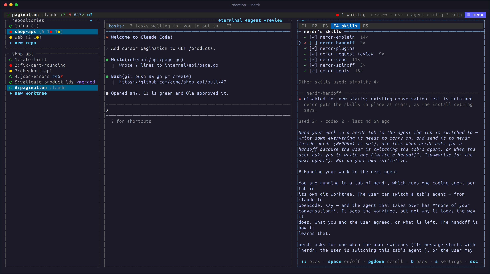

Skills are short instructions an agent reads when a task calls for them.
nerdr installs its own, so that the agents know how to use nerdr: how to
explain a change, ask for a review or message another agent. You do not
call them yourself; you ask in plain words, and the agent picks the skill.

## nerdr's skills

| Skill | What it lets the agent do | Described in |
|---|---|---|
| `nerdr-explain` | Explain a finished change, or walk through it, when asked | [Code changes](../code-changes/#explaining-a-change) |
| `nerdr-request-review` | Ask for a code review when the work is done | [Code review](../../use/code-review/#when-the-agent-says-it-is-ready) |
| `nerdr-send` | Message the other agents in the tab, start more, and follow them | [Agents working together](../../use/agents-together/) |
| `nerdr-spinoff` | Split work into new tabs | [Splitting work](../../use/agents-together/#splitting-work-into-new-tabs) |
| `nerdr-handoff` | Write down its work for the agent taking over | [Switching agents](../../use/agents-together/#switching-a-tabs-agent) |
| `nerdr-tools` | See every tab, run commands in a terminal you see, make tabs, search past conversations, check rate limits | [Commands for agents](../../reference/agent-commands/) |
| `nerdr-plugins` | Find and run your plugins | [Plugins](../../configure/plugins/) |

Their sources are in
[`skills/`](https://github.com/nerdr-dev/nerdr/tree/main/skills).

## The F4 screen

F4 shows each skill and whether the tab's agent has it: `✓` installed,
`~` an older copy that is updated at the next start, `✗` missing.

| Key | Action |
|---|---|
| `↑` / `↓` | Read a skill |
| `space` | Turn it on or off |
| `pgdown` / `b` | Scroll |
| `s` | Change where skills are installed |

F4 also counts how often the agents have used each skill, by agent and
when last, and lists the other skills the agents used. nerdr counts from
each agent's conversation log when a turn ends.

## Turning skills off



All skills start on. Each adds instructions and tool calls to the
agents' conversations, so turn off those you do not use, in F4 or with
`enabled_skills`:

```toml
enabled_skills = ["nerdr-explain", "nerdr-spinoff"]
```

An empty list turns all of them off. Restart running agents to reload
their instructions; turning a skill off cannot remove text already in a
conversation. A feature whose skill is off is not offered.

## Where skills are installed

`install` says where nerdr may write what it gives the agents: the skills,
and the hooks and plugins that tell nerdr what an agent is doing. You
choose on first start.

With **`install = "home"`**, nerdr installs for the agents found on your
PATH:

| Agent | Folder |
|---|---|
| Claude | `~/.claude/skills/` |
| opencode | `~/.claude/skills/`, or `~/.config/opencode/skills/` without Claude |
| Copilot | `~/.copilot/skills/` |
| Codex | `~/.agents/skills/` |
| Gemini | `~/.agents/skills/` |
| Antigravity | `~/.gemini/config/skills/` |
| Cursor | `~/.agents/skills/` or `~/.claude/skills/`; otherwise `~/.cursor/skills/` |

The agents then find the skills outside nerdr too.

With **`install = "worktree"`**, skills go in the folder each agent starts
in: `.claude/skills/` for Claude, opencode, Copilot and Cursor, and
`.agents/skills/` for Codex, Gemini and Antigravity, kept out of git
through `.git/info/exclude`. Use this for sandboxes that cannot reach your
home folder.

With **`install = "off"`**, nerdr installs nothing. Copy the folders from
`skills/` yourself; features are offered only when the agent finds the
skill.

nerdr updates its skills at every start. To keep your own edits to one,
remove the `<!-- nerdr: installed and kept up to date by nerdr … -->`
marker; files without it are left alone. Turning a skill off removes
nerdr's copies, but keeps your own.
