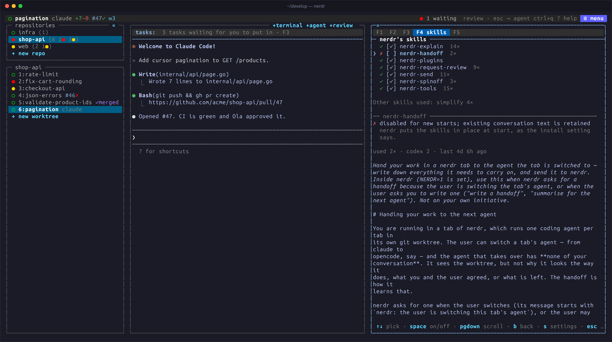

Skills are short instructions an agent reads when a task calls for them.
nerdr installs its own, so that the agents know how to use nerdr: how to
explain a change, ask for a review or message another agent. You do not
call them yourself; you ask in plain words, and the agent picks the skill.

## nerdr's skills

| Skill | What it lets the agent do | Described in |
|---|---|---|
| `nerdr-explain` | Explain a finished change, or walk through it, when asked | [Code changes](../code-changes/#explaining-a-change) |
| `nerdr-request-review` | Ask for a code review when the work is done | [Code review](../../use/code-review/#when-the-agent-says-it-is-ready) |
| `nerdr-send` | Message the other agents in the tab, start more, and follow them | [Agents working together](../../use/agents-together/) |
| `nerdr-spinoff` | Split work into new tabs | [Splitting work](../../use/agents-together/#splitting-work-into-new-tabs) |
| `nerdr-handoff` | Write down its work for the agent taking over | [Switching agents](../../use/agents-together/#switching-a-tabs-agent) |
| `nerdr-tools` | Keep a line on where its work stands, see every tab, run commands in a terminal you see, make tabs, search past conversations, check rate limits | [Commands for agents](../../reference/agent-commands/) |
| `nerdr-plugins` | Find and run your plugins | [Plugins](../../configure/plugins/) |

Their sources are in
[`skills/`](https://github.com/nerdr-dev/nerdr/tree/main/skills). A skill
is a folder: its `SKILL.md`, and sometimes files beside it that the agent
reads only when it needs them, such as the walkthrough part of
`nerdr-explain`.

## The F4 screen

F4 has three lists. **nerdr** shows nerdr's skills and whether the tab's
agent has them: `✓` installed, `~` an older copy that is updated at the next
start, `✗` missing. **other** shows the skills in the folders the tab's
agent reads, and any others used, such as an agent's built-in or plugin
skills; nerdr can only read these, and does not turn them on or off. Both
are sorted by name. **context** shows what else the agent reads
at start: instruction files, rules, memory, MCP servers, and the note nerdr
adds itself. These are the places the agent's documentation names, narrowed
to what exists; for Cursor and Antigravity they are the usual places. The
list is read-only, shows only the names of MCP servers, and leaves out
servers from plugins and connectors.

| Key | Action |
|---|---|
| `tab` | Switch between the lists |
| `a` | Count use in this tab or in all tabs |
| `↑` / `↓` | Read a skill or file |
| `space` | Turn one of nerdr's skills on or off |
| `pgdown` / `b` | Scroll |
| `s` | Change where skills are installed |

F4 also counts how often each agent has used each skill and when it last
did, in the active tab until you press `a`. A conversation joins a tab's
count when nerdr counts it there, so older conversations may show only
under all tabs. nerdr counts from each agent's conversation log when a
turn ends. These are use counts, not measured token costs. One of nerdr's
skills shows **Without this skill** first: CLI examples, what the skill
adds, and what turning it off changes.

## Turning skills off



All skills start on. Their descriptions can take context before use;
reading their instructions, calling tools and doing the work also cost
tokens. Manual CLI use can avoid agent calls, but asking an agent to
read CLI help and do the same work still costs tokens. Reviews and new
agents still use tokens when started through the CLI.

Turn off skills you do not use in F4 or with `enabled_skills`:

```toml
enabled_skills = ["nerdr-explain", "nerdr-spinoff"]
```

An empty list turns all of them off. Claude notices a change by itself;
restart other running agents. Turning a skill off cannot remove text
already in a conversation. Your own copies of skills remain discoverable
until you remove them yourself.

**F1 explanations and walkthroughs, and handoffs requested when switching
agents, work with their skills off.** nerdr includes the necessary
instructions in those requests, only when you use the action. Keep
`nerdr-explain` and `nerdr-handoff` on if you want the agent to discover
those workflows from ordinary conversation too.

Turning off `nerdr-request-review` also changes automatic review: with
`when = "ready"`, nerdr falls back to reviewing each turn instead of
waiting for the agent to say it is ready. Turn automatic review off
separately if you want to avoid those reviews.

## CLI alternatives

Use `nerdr COMMAND -h` for options and input formats. Replace uppercase
placeholders with your values. Commands controlling tabs need the agent's
nerdr environment, including its connection to the running tab. Terminal
panes do not have that connection either: ask the agent to run the exact
command without loading a skill. Local note commands (`order`, `why`,
`walkthrough`) and plugin commands can also run from a shell. Agents should use
`"${NERDR_BIN:-nerdr}"` instead of `nerdr`. See [Commands](../../reference/agent-commands/).

| Skill | Commands without the skill | What you supply or lose |
|---|---|---|
| `nerdr-tools` | `nerdr status "Working"`, `nerdr tabs`, `nerdr terminal npm run dev`, `nerdr terminal --restart terminal`, `nerdr read terminal`, `nerdr close terminal`, `nerdr tab new --branch fix/example "Task"`, `nerdr search WORDS`, `nerdr search --show ID`, `nerdr usage` | Individual actions still work. The agent loses guidance on status updates, visible long runs and finding past decisions. Sandbox restrictions still apply. |
| `nerdr-send` | `nerdr agents`, `nerdr send 2 "Message"`, `nerdr agent --kind codex "Task"`, `nerdr wait --timeout 1m 2`, `nerdr read 2`, `nerdr close 2` | Supply complete tasks and coordinate replies yourself. Starting and messaging agents may still cost tokens; closing a pane stops its work. |
| `nerdr-plugins` | `nerdr plugin list`, `nerdr plugin run NAME --PARAM VALUE`, `nerdr plugin stop NAME` | Choose the plugin and parameters yourself. Permissions and confirmations remain; plugins for the user only open in F5. The skill also teaches watch handling and plugin creation. |
| `nerdr-request-review` | `nerdr request-review "Review focus"`, optionally `--agent codex` before the text | Request at the right time; the review starts after the agent's turn. The skill teaches when to request and what to highlight. Automatic review fallback is described above. |
| `nerdr-spinoff` | `nerdr spinoff plan.json` | Prepare the split, commits and full task descriptions as JSON. The command opens the confirmation dialog; it does not work out the plan. The agent also loses the reminder to use spinoff for new branches. `nerdr tab new` creates a tab directly, without that dialog or splitting existing changes. |
| `nerdr-handoff` | `nerdr handoff handoff.md` | Write the summary yourself. The command sends it; it cannot recover decisions from the conversation. The agent-switch dialog supplies writing instructions when needed. |
| `nerdr-explain` | `nerdr order add --short "Summary"`, `nerdr order add --file FILE --role core --short "Role"`, `nerdr why add --file FILE --anchor "Line" --short "Reason"`, `nerdr walkthrough add walkthrough.json` | Write the explanations and walkthrough structure yourself. These commands record content rather than generate it. E and g / G in F1 supply writing instructions when needed. |

## Where skills are installed

`install` says where nerdr may write what it gives the agents: the skills,
and the hooks and plugins that tell nerdr what an agent is doing. You
choose on first start.

With **`install = "home"`**, nerdr installs for the agents found on your
PATH:

| Agent | Folder |
|---|---|
| Claude | `~/.claude/skills/` |
| opencode | `~/.claude/skills/`, or `~/.config/opencode/skills/` without Claude |
| Copilot | `~/.copilot/skills/` |
| Codex | `~/.agents/skills/` |
| Gemini | `~/.agents/skills/` |
| Antigravity | `~/.gemini/config/skills/` |
| Grok | `~/.agents/skills/` |
| Cursor | `~/.agents/skills/` or `~/.claude/skills/`; otherwise `~/.cursor/skills/` |

The agents then find the skills outside nerdr too.

Copilot's plugin, which tells nerdr what copilot is doing, is not put in
the home folder, where a sandbox may let its copilot change it for every
copilot (cplt gives copilot `~/.copilot`). nerdr gives each copilot it
starts one with `--plugin-dir`: a copilot in a sandbox gets one in its
tab's `.copilot/nerdr-plugin/`, kept out of git, and one outside a
sandbox nerdr's own in `~/.local/state/nerdr/copilot-plugin/`, which a
sandbox must not let its agent write. A `~/.copilot/nerdr-plugin/` an
earlier nerdr wrote is no longer used; nerdr leaves it, and you can
remove it.

A sandbox that lets its agent write these home folders lets it change
what agents outside a sandbox load from them. nerdr's sandbox check warns
of that; see [what a sandbox must deny](../../configure/agents/#what-a-sandbox-must-deny-when-the-core-runs-on-its-own).

With **`install = "worktree"`**, skills go in the folder each agent starts
in: `.claude/skills/` for Claude, opencode, Copilot and Cursor, and
`.agents/skills/` for Codex, Gemini, Antigravity and Grok, kept out of git
through `.git/info/exclude`. Use this for sandboxes that cannot reach your
home folder. Grok reads a project's skills only once you trust its folder.

With **`install = "off"`**, nerdr installs nothing. Copy the folders from
`skills/` yourself for discovery through conversation. F1 explanations,
walkthroughs and agent-switch handoffs still carry their own instructions.

nerdr updates its skills at every start. To keep your own edits to one,
remove the `<!-- nerdr: installed and kept up to date by nerdr … -->`
marker from the file; files without it are left alone. Turning a skill off removes
nerdr's copies, but keeps your own.
