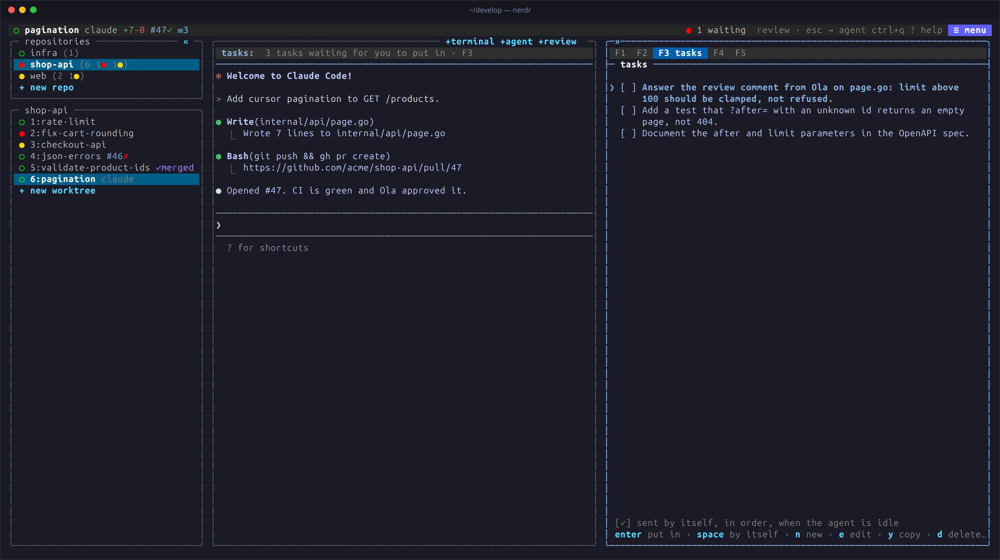

Had an idea while the agent is busy? Don't interrupt it. Press
`ctrl+q m`, write the task, and it waits in F3 until you, or nerdr, give
it to the agent.



## Queuing a task

`ctrl+q m` queues a task for the agent whose pane has the keyboard, and
`ctrl+q M` for several tabs at once. nerdr opens F3 to show it among the
tab's tasks. The status panel above the agent (`tasks:`) and the `✉n`
badge on the tab show how many are waiting.

## Sending tasks

- **By hand:** when the agent is idle, `enter` on a task puts it in the
  agent's prompt for you to edit or send.
- **By itself:** tick a task with `space`, or `tab` in the task dialog,
  and it is sent at the agent's next idle prompt. Ticked tasks are sent in
  order.

nerdr never types a task in while the agent is asking a question, nor
while a code review is going on. If the agent shows no response within
five seconds, nerdr pauses the rest of the queue (`✉n⏸`) until you visit
the tab, so the order is kept.

## Editing

| Key | Action |
|---|---|
| `↓` | Select the first task; F3 opens with none selected |
| `n` | Add a task |
| `e` | Edit |
| `y` | Copy |
| `d` | Delete |
| `J` / `K` | Move down / up |

The selected task is shown in full, the others in two rows. Tasks survive
restarts.

## Saved prompts

Some prompts you type again and again: "commit, push and open a pull
request", "rebase on main". Save them once, and pick one instead of
writing it out.

`ctrl+q l` lists them. Type to filter, then `enter`, or press a prompt's
number. It is typed into the agent whose pane has the keyboard, and
nerdr either presses enter after it to send it (`⏎`) or leaves it in the
prompt for you to change or send (`✎`). Each prompt has its own setting;
`tab` turns it on and off while you write one. `ctrl+n` saves a new
prompt, `ctrl+e` changes the one selected.

`→` in F3 shows the same list beside the tab's tasks, and `←` goes back:

| Key | Action |
|---|---|
| `enter` | Use the prompt |
| `space` | Switch between sending it (`⏎`) and only typing it in (`✎`) |
| `n` | Save a new prompt |
| `e` | Edit |
| `y` | Copy |
| `d` | Delete |
| `J` / `K` | Move down / up |

The prompts are the same in every repository. They are kept in
`~/.config/nerdr/prompts.toml`, which you can also edit by hand:

```toml
[[prompt]]
text = "commit, push and open a pull request"
enter = true
```

## What else ends up here

- Findings from a [code review](../../use/code-review/) you chose to keep
  for later.
- Requests from *My PRs* in [F2](../github/): review comments and CI
  fixes for another tab.
- A message from a sandboxed agent to an agent outside a sandbox, which
  waits for you rather than being typed in.
