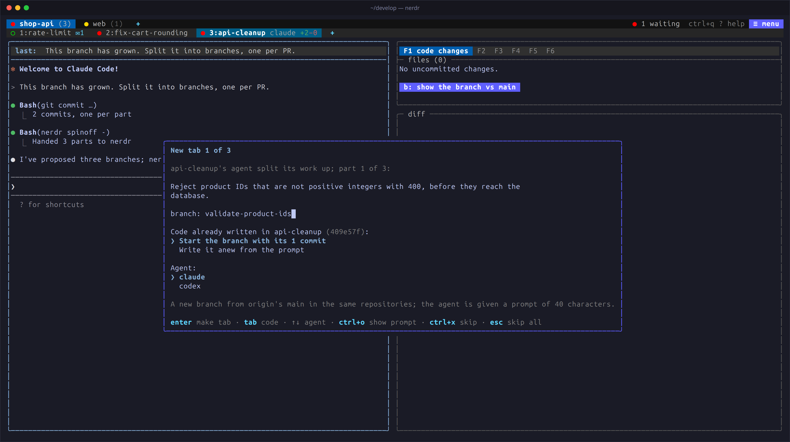

import { Aside } from '@astrojs/starlight/components';

nerdr teaches its agents to use nerdr. Through a handful of commands and
the [skills](../../panel/skills/) that explain them, an agent can talk to
the other agents in its tab, start more of them, see the other tabs, run
a dev server in a terminal you see, and split its work into new tabs.
You ask in plain words; the agent knows the command.

## Messages between agents

Ask agent 1 to *"send the plan to agent 2"*, and agent 2 gets it as a
task, typed in when it is idle, marked as coming from agent 1 and saying
how to answer. Agents do this with `nerdr send`, which the `nerdr-send`
skill teaches them. `nerdr send` without a number lists the tab's agents.

<video autoPlay loop muted playsInline controls aria-label="Claude and Codex play chess in one tab, sending moves with nerdr send, beside a terminal with the board" style="width:100%">
	<source src={import.meta.env.BASE_URL.replace(/\/?$/, "/") + "chess.webm"} type="video/webm" />
	<source src={import.meta.env.BASE_URL.replace(/\/?$/, "/") + "chess.mp4"} type="video/mp4" />
</video>

Above, Claude and Codex play chess in one tab: Claude opens the board in a
terminal and starts Codex, and they send each other moves with
`nerdr send`.

## Starting more agents

Ask agent 1 to *"start a codex agent to write the tests"*, and a new pane
opens beside it with that task. The new agent reports back to agent 1
with `nerdr send`, and the keyboard stays where it was. Agents can name
the kind of agent and its model, in the agent's own names (`haiku` for
claude, say).

Agents in a tab share its worktree, so the skill tells them to give each
agent its own files. To have several agents try the same task, ask for a
spinoff instead (below), so each gets a worktree of its own.

<Aside title="Try it">
*"Start two agents: one updates the docs, one writes tests for the new
endpoint. Wait for both and tell me when they are done."*
</Aside>

## What agents can see and do

| Command | What it does |
|---|---|
| `nerdr agents` | The tab's agents: number, kind, model, state, context |
| `nerdr wait N…` | Wait until those agents are done or ask something |
| `nerdr read N` | What agent N or a terminal pane shows, as text |
| `nerdr terminal CMD` | Run a command in a new terminal pane you see |
| `nerdr tabs` | Every tab: branches, changes, pull request, CI, agents |
| `nerdr status TEXT` | Set the line on where the work stands, above the agent |
| `nerdr tab new` | A tab on a new branch, its agent given a task |
| `nerdr search WORDS` | Past claude and codex conversations |
| `nerdr usage` | The Claude and Codex plans' rate limits |

The full list, with options, is in
[Commands for agents](../../reference/agent-commands/). Agents close a
terminal or another agent's pane only when you ask, and only you close
tabs and the tab's first agent.

## Splitting work into new tabs

Ask the agent to *"split this into branches"* or *"make a branch for the
parser fix"*. The `nerdr-spinoff` skill has it commit each part separately
and ask nerdr for a tab for each. The tab turns red, and a dialog shows
each part with a summary and a branch name you can edit:

- If the agent supplied commits, choose whether to cherry-pick them onto
  a fresh branch from main, or let the new agent do the task from its
  prompt.
- Pick the agent for the part with `↑` / `↓`.
- In a tab on several repositories, tick the repositories the part
  changes; a part in one repository gets a plain tab for it.
- `ctrl+o` shows the new agent's prompt, `enter` creates the tab,
  `ctrl+x` skips this part and `esc` skips the rest.

The original agent is told the new tabs and branch names, and reminded to
leave the moved commits out of its own pull request. Commits that do not
apply cleanly are left out, and the new agent is told to make those
changes itself.

## Switching a tab's agent

`ctrl+q a s` replaces the tab's agent with another, in the same worktree.
While the current agent runs, choose how to pass on what it knows:

- **Switch now.** nerdr turns the conversation into a handoff file for
  the new agent: your messages, the agent's replies and one line per tool
  call.
- **Ask for a handoff first.** The old agent writes down the goal,
  decisions, findings, what is done and what remains, and hands it over
  with `nerdr handoff`. The status panel shows `swap:` meanwhile; press
  `ctrl+q a s` again to switch at once or cancel. If no handoff comes
  within five minutes, nerdr switches as above.

The new agent reads the worktree, sums up its understanding and waits for
you. Switching back to an earlier agent resumes its conversation and
tells it what happened in between.

## Questions from agents

Agents ask their questions in their own conversation, where you answer
them. An agent asking is marked as needing input, its tab turns red, and
it is first in the [waiting list](../progress/#the-waiting-list).
