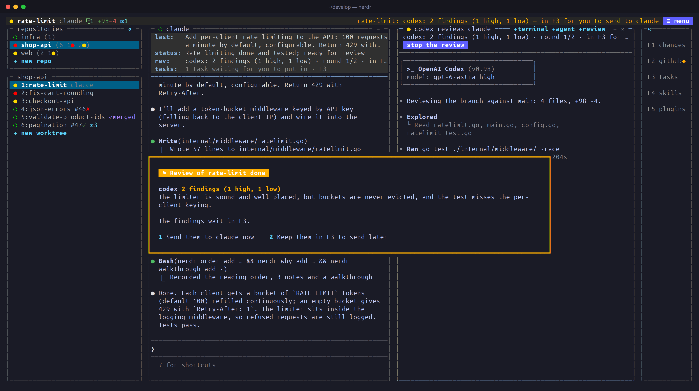
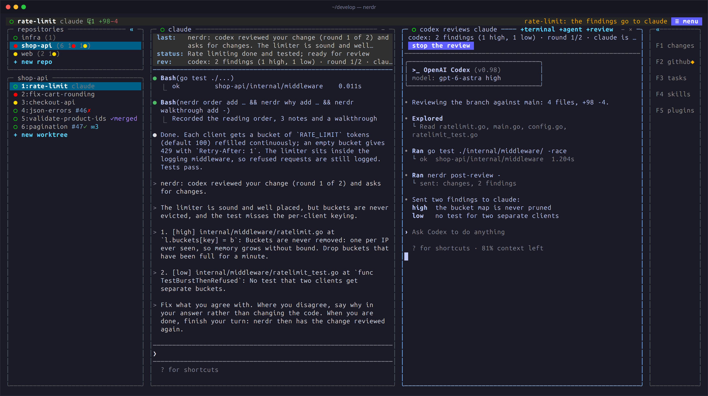

import { Aside } from '@astrojs/starlight/components';

A second agent reads what the first one did, with fresh eyes and without
its conversation. Its findings go back to the agent that did the work,
which fixes them; then the reviewer checks again. Codex reviewing Claude's
work, or Claude reviewing Codex's, catches mistakes neither would catch
alone.

## Starting a review

In the pane of the agent whose work is to be reviewed, click `+review` or
press `ctrl+q t r` (or `ctrl+q a c`). A review pane opens beside it,
listing the agents to review with; the configured reviewer is first.
Press `enter`, its number, or click to start.

- `m` picks the model the highlighted agent reviews with, from the models
  the agent itself lists; type to narrow, or type one it does not list.
- `-` / `+` change the number of rounds.
- `esc` closes the pane.

A review is always of one agent's work, and its findings go back to that
agent. Several agents in a tab can each be reviewed.

### When the agent says it is ready

With the `nerdr-request-review` skill, the agent asks you when it has
finished whether you want a review, and starts one if you say yes. Name
the reviewer you want, *"have codex with astra review it"*, and it passes
that on.

### Automatic reviews

Set `[review] auto = true` to review without asking. By default the
review starts when the agent says its work is ready, with what it wants
looked at most; `when = "turn"` reviews after every turn that changes the
worktree. See [Configuration](../../configure/configuration/#review).

## What the reviewer does

The reviewer runs in the same worktree. It reads the branch's commits and
the uncommitted changes, is told to change nothing, and sends a verdict, a
summary and findings on specific lines.

While it reviews, tasks queued for the agent wait, so nothing changes
under the reviewer. The status panel shows `rev:` with the round and what
the reviewer is doing.

## Findings

Findings appear beside the code in F1, marked `⚑`, and in F3. When a
round ends, nerdr asks in the tab whether to send them to the agent now
or keep them in F3; in another tab, it asks when you come back. With
`send_findings = "auto"` they are sent without asking.

After the agent has addressed them, the reviewer checks again, in its own
conversation. This goes on until it approves, or the `rounds` limit is
reached (2 by default); remaining findings then wait for you in F3.

## Several reviewers

Select `+ reviewer` while a review is underway, or open another review
pane from the agent. You can run one reviewer of each agent kind. A round
ends when all of them have answered, and their findings are sent together
in one numbered message. Reviewers that approve stop and their panes
close; the others check the fixes.

## The review pane

The reviewer runs in its own pane, under a line on how the review stands.
Go to the pane to answer its questions. A review that starts by itself
opens beside the agent without taking the keyboard, and is the first to be
minimised when room runs out. Stop it with the stop button, `×`,
`ctrl+q t x` in its pane, or `ctrl+q a x` from the agent. The pane closes
when the review ends.

Reviews are kept in `reviews.jsonl` beside nerdr's notes. The latest
findings remain after a restart, but reviewers are not restarted.

<Aside type="tip" title="Read-only reviewers">
Reviewers are told not to change files, but run with the agent's normal
settings. To enforce it, give them arguments of their own, such as
`[review.args] codex = ["--sandbox", "read-only"]`. See
[Configuration](../../configure/configuration/#review).
</Aside>
