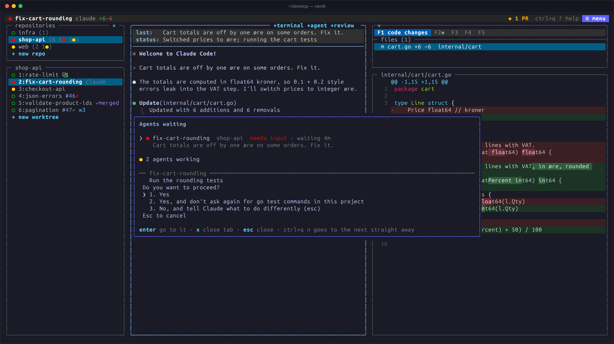

With several agents at work, the question is always the same: which one
needs me? nerdr answers it at a glance, and takes you there.

## Status lights

Every tab, and every agent in a tab, has a light:

| Light | Meaning |
|---|---|
| ● yellow | Working |
| ● red | Needs your input: a question or a permission |
| ● green | Done, and not yet seen |
| ○ | Seen, or idle |
| `z` blue | Asleep |

Set `status_lights = "symbols"` to tell them apart by shape as well:
◐ working, × needs input, ✓ done. A done tab counts as seen once you
have visited it while nerdr has focus.

nerdr knows an agent's state from the agent's own hooks where it has
them, and from its screen otherwise; see
[How it works](../../reference/how-it-works/#knowing-when-an-agent-is-done).

## The waiting list

The top bar counts the other tabs waiting for you, and turns red for
questions. Click it or press `ctrl+q w` for the waiting list: questions
first, then finished work, the oldest first, each with the agent's latest
message. `enter` goes to the tab, `x` closes it. Cold tabs are listed
below.

`ctrl+q n` skips the list and goes straight to the next agent waiting.

## Tab badges

The tab list shows more than the light:

| Badge | Meaning |
|---|---|
| `+98-4` | Lines changed on the branch |
| `#12✓` / `#12✗` | The pull request, its CI passing or failing |
| `✓merged` | The pull request is merged; the tab can be closed |
| `⚠` | Files this tab changes that another tab changes too |
| `✉2` | Tasks waiting in F3 |
| `❄` | Cold: no activity for `cold_days` days |

Later edits mark the CI result as outdated. `ctrl+q z d` hides the
details, and `tab_details = false` starts without them.

## Notifications

When nerdr's window does not have focus, it sends a desktop notification;
when you are in another tab, a message in the bar. `notify` chooses when:
`all` (the default), `blocked` (an agent needs input), `done` or `off`.
Inside herdr, notifications go through herdr.

nerdr also watches GitHub for you:

- **Your pull requests:** failed checks and new reviews, marked `◆` on F2
  until you look. `pr_notify = false` turns this off.
- **Issues assigned to you** in these repositories, checked every few
  minutes. `issue_notify = false` turns this off.

What happened while nerdr was stopped is reported at the next start.

## What happened while you were away

`ctrl+q h` shows a tab's history since your last visit: the agent's turns
and questions, messages sent, new commits, pull request and CI changes.
In F1, `◆` marks the files changed since your last visit.

## Usage and rate limits

`ctrl+q u` shows how much of your Claude and Codex plans' 5-hour and
weekly limits is used, when each resets, and how full each agent's
context window is. nerdr reads what the agents say themselves and never
asks their services or reads their sign-ins.

Codex writes its limits into its logs. Claude gives them only to its
status line, so nerdr starts claude with a status line of its own, which
reports the limits and then shows the status line you set in claude's
settings, or a short one of nerdr's. Set `claude_status_line = false` to
leave claude's status line alone.

## Searching past conversations

`ctrl+q /` searches what you and the agents said in the claude and codex
conversations held in your repositories and worktrees. Type words; the
conversations with all of them are listed, the latest first. `enter` goes
to the agent carrying the conversation on, or carries it on in a new pane
of the tab working in its worktree.

## Agents asleep

When nerdr starts, it starts the agents of the tab on screen first, and
the others a moment apart. Agents of cold tabs are not started: they are
asleep, shown with a blue `z`, until you visit the tab, and then carry
their conversations on.

Set `sleep_after` to a number of minutes to put agents to sleep while
nerdr runs, too: once a tab's agents are done, seen and out of sight for
that long, nerdr stops them. A tab stays awake while it has a task
waiting, a question, a code review, or an agent that could not carry its
conversation on. Terminals keep running, and a task queued for a sleeping
tab wakes it.

## Keeping the machine awake

Agents keep working behind a locked screen, but pause when the machine
sleeps. By default nerdr keeps the machine awake while an agent or
reviewer works, and for a minute after. See
[Keeping the machine awake](../../configure/configuration/#keeping-the-machine-awake).
