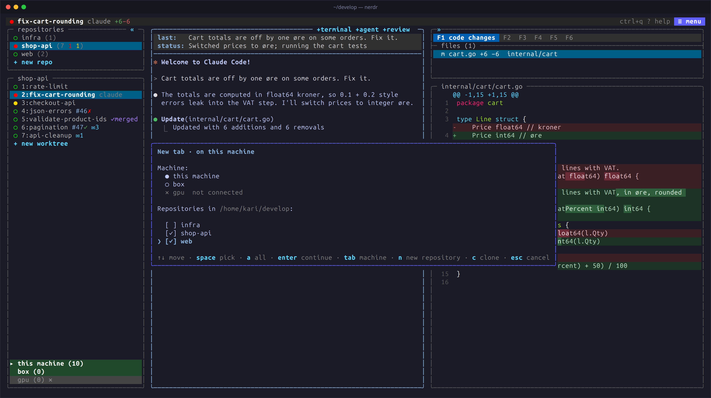

import { Aside } from '@astrojs/starlight/components';

Each task gets a tab with one branch across one or
[more repositories](#several-repositories-in-one-tab), and a Git worktree
of that branch in each. A worktree is a checkout of its own, in a folder
of its own. Agents in different tabs
cannot overwrite each other's changes, and your main checkout stays
separate from the work.

## Making a tab

Press `ctrl+q c`, click `+` after the tabs, or `+ new tab` in the
sidebar. Pick the repositories, name a branch and choose an agent. nerdr
lists the agents found on your PATH and asks only when there is more than
one. Press `tab` to reach the task field and type a first task; nerdr
sends it once the agent has started.

With [other machines](../../use/remote/#several-machines-in-one-nerdr) in
nerdr, the dialog lists the machines above the repositories, with the
one of the tab you are in chosen. `↑` from the first repository, or
`tab`, goes into that list; moving in it shows that machine's
repositories, and `↓` past the last machine, `tab` or `enter` goes back
to them. `ctrl+o` moves the dialog to the next machine too. A tab
can later [move to another machine](../../use/remote/#moving-a-tab-to-another-machine)
with `ctrl+q a m`.



Before creating a branch, nerdr fetches origin's default branch: the one
`origin/HEAD` names, such as `develop`, or else `main` or `master`. It
fast-forwards a local copy that is behind, but leaves one with local
commits unchanged. If fetching fails, it does not create the worktree.

Each connection to origin is a login, which with an SSH key behind
Touch ID, or a token in the keychain that asks for it, is a finger on
the reader. nerdr connects once per repository for a new tab: the fetch
that checks whether origin has the branch also brings its default branch
up to date, and that answer is used for the next minute. With a Git older
than 2.41, which cannot say what a fetch got, it connects three times for
a new branch.

New worktrees go in `~/worktrees-nerdr`, or the folder set in
`worktrees_dir`:

```text
~/worktrees-nerdr/<branch>-<repo>/                              # one repository
~/worktrees-nerdr/<branch>-<first>-and-<n>-more-<hash>/<repo>/  # several repositories
```

The repository name in the path lets you use the same branch name in
different repositories. With several, the folder is named after the
first repository and how many more there are, so the name stays short.
A hash of all their names keeps different sets in different folders.

## Adding and removing repositories

Press `ctrl+q g r`, or right-click the tab and choose *Repositories…*, to
change which repositories a tab works in. Tick a repository to add it.
It gets a worktree on the tab's branch, in a subfolder of the tab's
folder named after the repository. If the branch already exists in that
repository, the worktree continues it. Untick a repository to delete its
worktree; the branch is kept. A tab always keeps at least one
repository.

A tab with one repository has no subfolders yet, so adding a second
moves the first worktree into a subfolder of its own. The tab's agents
restart and continue their conversations, and its terminals close. When
you remove all but one repository, the tab moves back to that
repository's group, and its worktree stays where it is.

The tab's folder keeps its name, even when the name no longer matches
the repositories, since agents find their conversations by the folder
they start in. nerdr tells the tab's agents what changed.

## Starting points

### From an issue

Type `#123` as the branch name to work on issue 123, on GitHub or
GitLab. nerdr builds a
branch name from its title, such as `123-login-fails-…`, and gives the
agent the issue as its first task. Or pick one from your assigned issues
with `ctrl+q g o`, where you can read the task before the agent starts.

### From a pull request

With one repository picked, the branch step lists all its open pull
requests. Those that ask for a review from you or one of your teams are
marked `● review asked` and listed first. `↓` goes into the
list, and typing narrows it by number, branch, title or author. `enter`
opens the worktree the pull request is checked out in, or continues its
branch in a new one.

A pull request from a fork is fetched from origin's `refs/pull/<n>/head`
into a branch of its own, `pr-<n>-<branch>`. nerdr does not push such a
branch, since a push to origin would not reach the pull request.

### From an existing branch or worktree

An existing local branch is checked out as it is. If the branch exists on
origin, nerdr shows its merge and pull request status, and you choose
whether to continue it or start a fresh branch from main.

Worktrees without a tab are offered too: in the repository list, and
under the branch name for the repository picked. A tab opened on one
continues the agent's latest conversation in that worktree, even if you
had it outside nerdr.

### On top of another tab's branch

To build on a tab's work before it is merged, press `ctrl+q C` in that
tab, or right-click it and choose *New tab on …*. The new branch starts
where the tab's branch is, unpushed commits included. Its changes in F1,
its commit counts and its pull request are against that branch. Once that
branch is merged and deleted, they are against main again, and GitHub
moves the pull request to main.

nerdr remembers the base as `branch.<name>.nerdrBase` in the
repository's git config.

## Several repositories in one tab

A task can span several repositories, such as a backend and a frontend.
Tick each with `space` when making the tab, and nerdr makes a worktree in
each, on the same branch, in one folder where the agent starts. Press
`tab` to reach the group field and name the group, or leave it empty for
`multi`. Right-click a group and choose *Rename group…* to change it.

In F1 and F2, each repository has its own row, with its own changes and
pull request.

## New and cloned repositories

In the repository list, `n` creates a repository on `main` with an empty
first commit. nerdr also offers to create a private repository as its
origin, on [`repo_host`](../../configure/configuration/#notifications-and-pull-requests)
(GitHub, with `gh`, unless it says otherwise; GitLab with `glab`). `c`
clones an `owner/name` from `repo_host`, a `host/group/name` such as
`gitlab.com/group/app`, a URL or a local path; the short forms use `gh`
or `glab` when available, private repositories included.

When nerdr is started inside a repository, it uses the first `repo_dirs`
entry for these. Without one, the keys are unavailable.

## Getting a new worktree ready: `.nerdr.toml`

A new worktree holds only committed files. Put a `.nerdr.toml` at the
repository root to copy local files into it and install dependencies:

```toml
copy  = [".env", ".env.*", "certs"]   # from the main checkout; globs and folders allowed
setup = "npm ci"                      # run in the new worktree
```

The file can be committed or kept only in the main checkout. nerdr asks
for approval the first time it uses it and whenever it changes, since
`setup` runs as you, outside any sandbox. If you decline, nerdr creates
the worktree without copying files or running setup. A command with
terminal escapes or invisible characters in it shows them as escapes,
and the dialog says so; one too long for the screen scrolls, and yes
counts only once you have seen its end.

- `setup` runs only in a worktree on a new branch from the base. An
  existing branch, a pull request from a fork or a stacked branch holds
  code someone else wrote, perhaps an agent; there nerdr copies the files
  but leaves `setup` for you to run once you have read the code.
- Copying never overwrites files already on the branch, nor follows
  symlinks outside the repository.
- If a sandboxed agent has worked in the repository and `copy` contains
  any patterns, nerdr copies the files but skips automatic `setup`, even
  on a verified base commit or when no pattern currently matches. Copied
  files may contain agent-written code. Run setup inside the sandbox, or
  inspect the copied files and run it in your own terminal.
- If setup fails, nerdr says so and opens the tab anyway.
- For a long setup, press `esc` to hide the dialog. The tab opens beside
  the one you are in when ready, without taking the keyboard.
- `setup` is told the tab's ports, as below, so it can write them into
  an `.env`.

## Ports of the tab's own

Each tab gets a range of ports no other open tab has, so dev servers and
databases in tabs side by side don't fight over the same port. nerdr hands
the range out from a pool when the tab is made, and it is free for the
next tab once the tab is closed. A tab keeps its range while it is open,
across restarts of nerdr.

An agent asks for the range with `nerdr ports`, which prints the first and
last port, such as `20010 20019`. nerdr's skill tells it to, before it
starts a server. The command asks nerdr through the socket the agent
reports to, so it works in a sandbox with nothing more let through.
Terminals, plugins and the `setup` of `.nerdr.toml` get the same range in
`NERDR_PORT` (the first) and `NERDR_PORT_END` (the last), for a setup that
writes the port into an `.env`, or `npm run dev -- --port $NERDR_PORT` in a
terminal.

The ports are on the machine the tab runs on: a tab moved to another
machine gets a range there. `port_base` and `ports_per_tab` in the
[config](../../configure/configuration/#tabs) set where the pool starts and
how many ports each tab has; `ports_per_tab = 0` gives tabs none. Ranges
are handed out per nerdr: two nerdrs started in different folders can give
their tabs the same ports.

## Moving between tabs

`ctrl+q →` / `←` go to the next or previous tab, and the prefix stays
active while you move: `ctrl+q → →` goes two tabs right. `enter` or `esc`
stays in the tab selected, and a command acts on it: `ctrl+q → → x`
closes the tab two places right.

| After `ctrl+q` | Action |
|---|---|
| `→` / `←` | Next / previous tab |
| `↓` / `↑` | Move to the tab row / group row |
| `]` / `[` | Next / previous repository |
| `1`…`9`, `0` | Go to a tab in the group; `0` the last |
| `f` / `space` | Find a tab by name across groups |
| `n` | Go to the next agent waiting for you |
| `r` | Rename the tab |
| `shift+←` / `shift+→` | Move the tab left / right |

With the tab list in the sidebar, `↓` / `↑` move through a list and `←` /
`→` switch between repositories and tabs. The sidebar is as wide as its
longest name needs; drag its edge to set the width, and right-click the
edge to go back to automatic. Click `«` or press `ctrl+q l m` to shrink it
to status lights; `ctrl+q l t` moves the tabs to the top.

## Two tabs side by side

`ctrl+q l v` shows the tab and its neighbour side by side, and right-click
*Show beside …* puts any tab of the repository beside the current one.
`ctrl+q tab` or a click moves the keyboard between them, and `ctrl+q l s`
swaps the sides. Opening the review panel takes the right side; hiding it
brings the split back. Splits survive restarts.

## Many tabs

When tabs overflow the bar, badges at its edges count those hidden, such
as `◂ ●2`, with the most urgent light among them. Click one to go there.

`max_tabs` limits open tabs to 20 by default. At the limit, nerdr offers
to close tabs whose pull requests are merged, and cold tabs. A tab with no
activity for `cold_days` days (5 by default) is marked ❄. When nerdr
starts, the agents of cold tabs sleep until you visit them; see
[Agents asleep](../progress/#agents-asleep).

## Closing a tab

Press `ctrl+q x`, or middle-click the tab. nerdr stops its agents and
asks what to keep:

| Key | Result |
|---|---|
| `y` | Delete the worktree and the branch |
| `w` | Delete the worktree, keep the branch |
| `k` | Keep both |
| `n` | Cancel |

`enter` is `y` when the branch's pull request is merged, and `w` when it
is not; the dialog says which. nerdr warns about uncommitted changes and
unpushed commits, and asks again with `Y` before deleting them.

<Aside>
Closing nerdr (`ctrl+q q`, then `enter`) or its window leaves the agents
working: start nerdr in the same folder to see them again, the same
processes. Quit (`ctrl+q q q`) stops them, and the next start brings
back every tab, each agent continuing its conversation.
</Aside>
